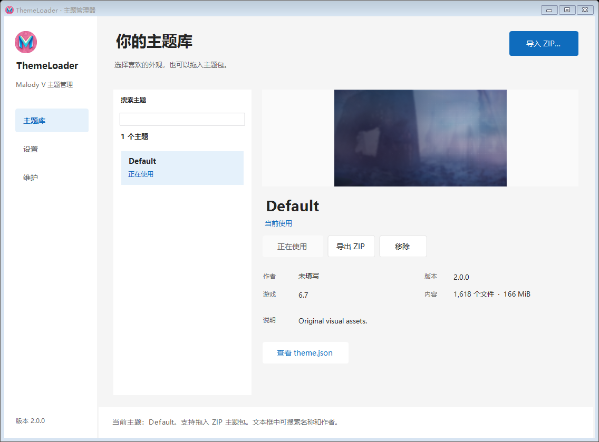
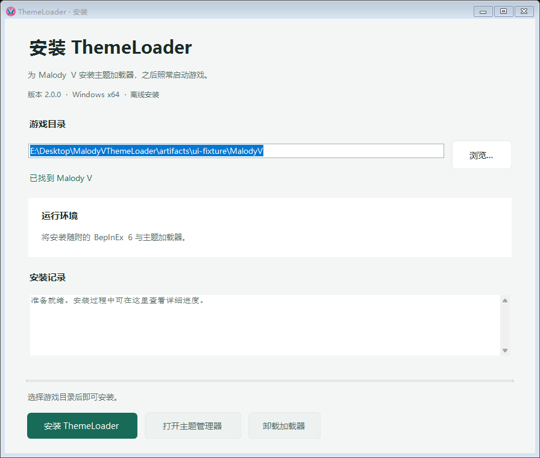

# Malody V ThemeLoader

面向 Windows x64 / IL2CPP 的 Malody V 主题加载器，包含离线安装器和桌面主题管理器。

- 安装一次，之后照常从 Steam 启动游戏。
- 自动复用兼容的 BepInEx 6 IL2CPP 环境。
- 使用主题在 themes 目录中以可编辑文件夹存储；ZIP 作为导入导出格式，兼容导入旧 `.mtp`。
- 支持图片、字体、Live2D 纹理和循环背景视频；缺少资源时使用游戏原始外观。
- Default 由源工程原始资源生成，可导出作为主题制作起点。
- 主题搜索与预览、实时更新、画面控制，以及按清单修复和卸载。
- 界面基于 Microsoft Fluent 2 和 Windows 11 Mica 规范，旧系统自动回退到中性背景。
- 管理器会检查 GitHub Releases，下载并校验新版安装器后自动关闭并完成更新。

安装器与管理器无需协议阅读、设备授权或机器码校验。





构建和验证使用 PowerShell 7：

```powershell
dotnet build MalodyVThemeLoader.slnx -c Release
pwsh -NoProfile -File scripts/build-release.ps1
pwsh -NoProfile -File scripts/test-runtime-reuse.ps1
pwsh -NoProfile -File scripts/test-theme-manager.ps1
python scripts/verify-payload.py
pwsh -NoProfile -File scripts/publish-github-release.ps1
```

离线 EXE、Default 目录 和 SHA-256 校验文件输出到 `artifacts/release`。
详见 [开发指南](docs/DEVELOPMENT_GUIDE.md)、[踩坑记录](docs/PITFALLS.md)、[Fluent 2 视觉基准](docs/FLUENT_2.md)和[桌面设计约定](DESIGN.md)。
